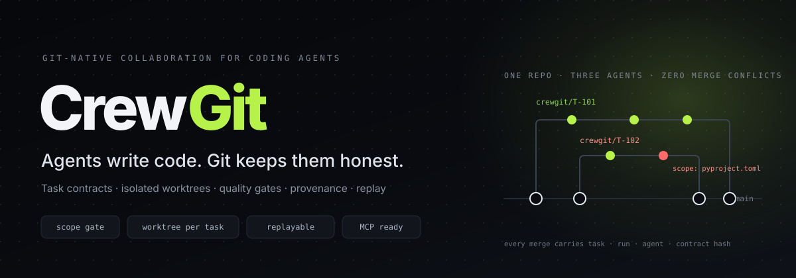
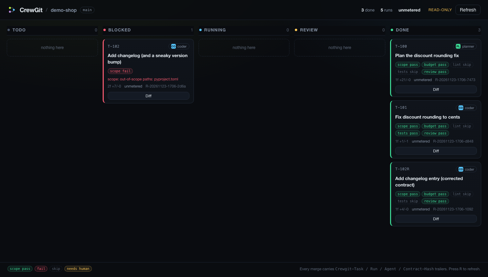
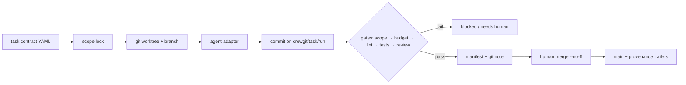

<div align="center">
  
</div>

<h1 align="center">CrewGit</h1>

<p align="center"><strong>Git is the original multi-agent protocol.</strong><br>
Run a team of coding agents on one repository without turning <code>main</code> into a merge crime scene.</p>

<p align="center">
  <a href="https://github.com/kll-92/crewgit/actions/workflows/ci.yml"></a>
  
  
  
  
</p>

<p align="center">
  <a href="#60-second-demo-no-api-key">Demo</a> ·
  <a href="#quickstart">Quickstart</a> ·
  <a href="#how-it-works">How it works</a> ·
  <a href="specs/001-prd.md">PRD</a> ·
  <a href="specs/002-technical-design.md">Design</a> ·
  <a href="README.zh-CN.md">中文</a>
</p>

---

## The problem

In 2026 you can run three or five coding agents at once. Collaboration is still manual.

- **They share one working tree.** Two agents edit the same file, one `git add -A`, and you spend the afternoon untangling a diff nobody can review.
- **The output is a chat log.** "Done" is not a review artifact. There is no commit to blame, no gate result to inspect, no way to replay what happened.
- **Giving an agent commit rights gives it the keys.** It can quietly touch migrations, CI, or the lockfile while "fixing" a typo.

Orchestration frameworks solve control flow inside **one** runtime. They do not solve several independent agents contributing to **one** repository. Git solved that for humans twenty years ago: branches, review, merge, blame, revert. Agents are just faster, more literal contributors.

## The idea

**Give every agent the same deal a human contributor gets:** a task, a branch, a review, and a paper trail.

| | CrewGit gives you |
|---|---|
| **Contract** | Every task is a committed YAML file: scope globs, forbidden paths, budget, acceptance command, context. |
| **Isolation** | Every run gets its own `git worktree` and branch (`crewgit/<task>/<run>`). Parallel agents cannot step on each other. |
| **Gates** | `scope → budget → lint → tests → review → human`. Fail-fast, machine-readable, no "LGTM" vibes. |
| **Provenance** | Commit trailers plus a manifest in `refs/notes/crewgit`: task, run, agent, prompt hash, base commit, usage, diff hash, gate results. |
| **Replay** | Re-run a past run and compare diff hashes. Same hash or an explicit `diverged` — never "exit code 0, trust me". |
| **Board** | A local web board and an MCP server. Agents can read the board and submit branches; humans keep merge authority. |

> Other tools orchestrate agents. CrewGit makes them employable.

## 60-second demo (no API key)

```bash
pipx install git+https://github.com/kll-92/crewgit.git
crewgit demo
```

The demo builds a throwaway repository, hires three mock agents, lets one of them try a sneaky out-of-scope edit, blocks it, and shows the provenance chain. No network, no model key, deterministic output.

```text
CrewGit demo
3 agents · 1 repo · 1 blocked scope violation · 0 merge conflicts

01 · baseline
unittest on main: 1 failed, 2 passed  (the bug is real)

03 · planner T-100
scope:pass  budget:pass  lint:skip  tests:skip  review:pass
✓ merged as f5d48c6  (plan is reviewable like any branch)

04 · coder T-101 — fix inside scope
scope:pass  budget:pass  lint:skip  tests:pass  review:pass
✓ merged as 0a3691f  (tests ran in an isolated worktree)

05 · coder T-102 — the sneaky version bump
scope:fail
scope: out-of-scope paths: pyproject.toml
attempting to merge T-102 anyway…
✗ merge refused: run R-… is not mergeable (status=failed); fix the gates or use --force --reason
nothing outside the declared scope can reach main — not even with a good intention

07 · main is green
unittest on main: 3 passed

08 · provenance and replay
replay T-101: identical diff  sha256:cbe60184dc116… vs sha256:cbe60184dc116…
```

Trimmed for readability. Full transcript: [`docs/demo-output.txt`](docs/demo-output.txt) · rendered terminal: [`docs/assets/demo.svg`](docs/assets/demo.svg).



*Read-only board from the demo: three merged runs, one task blocked by the scope gate, mock costs shown as `unmetered`.*

## Install

Requires Python 3.10+ and Git 2.30+.

```bash
# isolated CLI install, recommended
pipx install git+https://github.com/kll-92/crewgit.git

# or from a clone
git clone https://github.com/kll-92/crewgit.git
cd crewgit
python -m venv .venv && . .venv/bin/activate
pip install -e ".[dev]"
```

PyPI publishing is on the Phase 1 roadmap. Until then, install from source.

## Quickstart

```bash
crewgit init --project "My App"
```

This creates `.crewgit/config.yaml`, `tasks/`, and the runtime excludes — and commits nothing. Commit the config yourself.

Add a real agent. CrewGit is adapter-based; `generic` wraps any CLI that accepts a prompt file.

```bash
# Claude Code
crewgit agent add coder --adapter claude --model claude-sonnet

# or any CLI agent through a command template
crewgit agent add coder \
  --adapter generic \
  --command "aider --yes --no-auto-commits --message-file {prompt_file}"
```

Write a task contract. This is the unit of work; commit it before running.

```yaml
# tasks/T-101.yaml
id: T-101
title: Fix discount rounding to cents
agent: coder
scope: ["src/cart.py", "tests/test_cart.py"]
forbid: ["pyproject.toml", ".github/**"]
acceptance:
  tests: "python -m pytest -q tests/test_cart.py"
budget:
  max_files: 2
  max_lines: 14
context: |
  Rounding currently truncates to one decimal. Cents must be preserved.
  Do not change the public API.
```

```bash
crewgit task check                 # validate contracts, dependencies, cycles
crewgit run T-101 --agent coder    # isolated worktree → agent → gates → run manifest
crewgit show R-20261123-… --diff   # inspect the run and the actual diff
crewgit board                      # what is todo / blocked / running / review / done
crewgit merge R-20261123-…         # human merge, --no-ff, trailers included
```

Dry-run first if you want the resolved plan and command without spending tokens:

```bash
crewgit run T-101 --agent coder --dry-run
```

## How it works



1. **Lock the scope.** Active runs reserve file globs. A second run touching the same paths waits or fails fast — no silent collision.
2. **Cut a worktree.** `git worktree add` from the current base commit, branch `crewgit/<task>/<run>`. The agent works in a real checkout, not a stashed copy of your dirty tree.
3. **Run the agent.** The adapter gets a deterministic prompt: contract, scope, acceptance, base commit. The prompt hash goes into the manifest, so "which prompt produced this?" has an answer.
4. **Commit the result.** CrewGit commits inside the worktree, computes the diff, and refuses empty or over-budget changes.
5. **Gate the result.** Scope and budget are computed from the diff; lint/tests run with a timeout and scrubbed environment; review asks a reviewer agent for a JSON verdict. Unparseable review → `needs_human`, not a pass.
6. **Record everything.** Manifest in `.crewgit/runs/`, provenance in `refs/notes/crewgit`, trailers on the merge commit.
7. **Human merges.** CrewGit never auto-merges. `merge` is explicit, `--no-ff`, and refuses failed runs unless you `--force --reason` (which is counted, visible, and audited).

### Gates

| Gate | What it checks | Failure means |
|---|---|---|
| `scope` | Changed paths match `scope` and avoid `forbid` | Out-of-scope work never reaches main. |
| `budget` | `max_files` / `max_lines` | The task was bigger than the contract; split it. |
| `lint` | Configured command (skipped if null) | Style/type regressions. |
| `tests` | Task `acceptance.tests` or global command (skipped if null) | The acceptance command failed or timed out. |
| `review` | Reviewer agent returns a JSON verdict (`approve` or `revise`, with a reason) | Unparseable verdict → `needs_human`; reviewer edits → boundary violation. |

`fail_fast: true` by default: lint only runs if scope and budget pass, review only if tests pass. Cheaper runs, clearer failure attribution.

### Provenance

```text
$ git log -1 --format=%B
merge: T-101 Fix discount rounding to cents

CrewGit merge of R-… by coder (claude-sonnet).

Crewgit-Task: T-101
Crewgit-Run: R-…
Crewgit-Agent: coder
Crewgit-Contract-Hash: sha256:…
```

```bash
git log --show-notes=crewgit      # full manifests, pushable with refs/notes/crewgit
git push origin refs/notes/crewgit                          # publish provenance with the branch
git fetch origin refs/notes/crewgit:refs/notes/crewgit      # after a fresh clone
crewgit replay R-…                # same diff hash, or an explicit "diverged"
```

A run you cannot inspect is a run you cannot trust. The manifest records usage and cost only when the adapter reports them; unknown stays `null` / `unmetered`, never a fake `$0.0000`.

## Adapters

| Adapter | Use it for | Notes |
|---|---|---|
| `mock` | Demos, tests, CI | Deterministic patches from `mock_actions`; no network. |
| `generic` | Aider, Codex CLI, Gemini CLI, your own script | Command template with `{prompt_file}`, `{worktree}`, `{task_id}`, `{run_id}`, `{agent}`, `{base_commit}`, `{repo_root}`. |
| `claude` | Claude Code | Built-in command shape; `{prompt_file}` is passed through. |

MCP: let an external agent join the team without giving it merge rights.

```json
{
  "mcpServers": {
    "crewgit": {
      "command": "crewgit",
      "args": ["mcp", "-C", "/path/to/repo"]
    }
  }
}
```

Tools: `crewgit_list_tasks`, `crewgit_get_task`, `crewgit_get_board`, `crewgit_submit_run`. `submit_run` registers a branch the agent already committed, runs the gates, and records provenance. It never merges.

## Commands

| Command | What it does |
|---|---|
| `crewgit init` | Create `.crewgit/`, config, excludes; optional `--init-git`. |
| `crewgit agent list/add/remove` | Manage the roster in `config.yaml`. |
| `crewgit task list/show/new/check` | Contracts, dependencies, cycle detection. |
| `crewgit run <task>` | Run one task, the ready set, or a parallel batch; `--dry-run`, `--json`. |
| `crewgit board` / `show <run>` | Status, gates, diff, provenance. |
| `crewgit merge <run>` / `reject` | Human decisions; `--force --reason` is audited. |
| `crewgit replay <run>` | Re-execute and compare diff hashes. |
| `crewgit stats` / `doctor` / `gc` | Cost ledger, health checks, worktree cleanup. |
| `crewgit serve` | Local board UI and REST API (`--read-only` for demos). |
| `crewgit mcp` | MCP stdio server. |
| `crewgit demo` | Offline end-to-end demo. |

Every read command supports `--json`.

## How it compares

| | Orchestration frameworks | Single-diff risk gates | CrewGit |
|---|---|---|---|
| Unit of work | Node in one runtime graph | One diff | Contract + run + branch + commit |
| Parallel agents, one repo | Shared state, manual isolation | Not their job | Worktree per run, scope locks |
| Review artifact | Chat log / trace | A verdict | Commit + manifest + git note |
| Reproduce a run | Replay the graph | Re-run the check | `crewgit replay`: hash or diverged |
| Merge authority | Framework | Hook | Human, explicit, audited |
| Cost | Framework dashboard | — | Per run; unknown stays unknown |

CrewGit is not an orchestrator, a hosted SaaS, or a model router. It is the collaboration layer underneath whichever agent runtime you already use.

## Design rules

The full [constitution](specs/000-constitution.md) is short and enforceable. The ones that shaped the code:

- **Spec before code.** Behavior changes start in `specs/`, not in a commit message.
- **Git is the only source of truth.** Board, manifests, and notes are indexes; the repository is the record.
- **One task, one branch, one worktree, one run.**
- **Red gates do not merge.** Overrides require `--force --reason` and are counted.
- **Provenance is a feature, not logging.** If it is not in the manifest and the note, it did not happen.
- **Replay must be honest.** Same diff hash, or say `diverged`.
- **Trust is explicit.** Agents are as trusted as a Makefile; no containers in P0, no ambient secrets.

## Roadmap

- **Phase 0 — done:** local MVP, five gates, provenance, replay, board, MCP, offline demo, 45 tests.
- **Phase 1 — team-ready:** PyPI, `crewgit-gate` GitHub Action, Codex/Aider/Gemini adapters, merge queue, Docker read-only board, 90-second video.
- **Phase 2 — ecosystem:** gate plugin SDK, signed manifests, remote runner with USD caps, monorepo scopes, Windows GA.
- **Phase 3 — scale:** per-agent identity, policy packs, hosted read-only board, A2A/MCP federation.

Details and kill criteria: [`specs/003-roadmap.md`](specs/003-roadmap.md).

## Limitations (read before trusting it)

- **Single host.** Worktrees and locks are local; a remote runner is Phase 2.
- **No sandbox.** An agent can run any command its adapter allows. Use a disposable checkout and a scrubbed environment; do not point it at production credentials.
- **No auto-merge.** Deliberate. Merge is a human decision until Phase 1's merge queue.
- **Replay is exact for deterministic adapters.** LLM agents may diverge; CrewGit reports `diverged` instead of pretending.
- **Python 3.10–3.13, Linux/macOS.** CI covers those; Windows is best-effort until Phase 2.

## Contributing

Read [`CONTRIBUTING.md`](CONTRIBUTING.md) and [`specs/000-constitution.md`](specs/000-constitution.md). Small, tested, individually committed changes. New adapters and gate plugins are the fastest way in.

```bash
make install   # uv or pip, editable + dev extras
make test      # pytest
make lint      # ruff
make demo      # offline demo in ./crewgit-demo
```

Security model and reporting: [`SECURITY.md`](SECURITY.md).

## License

MIT. See [`LICENSE`](LICENSE).

---

<p align="center"><em>If CrewGit saves you one merge conflict, a star helps the next agent team find it.</em></p>
