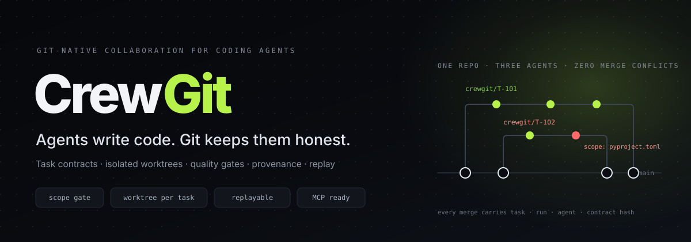
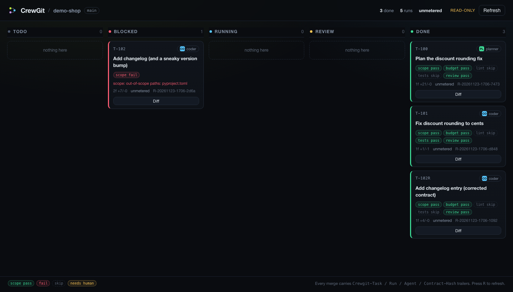
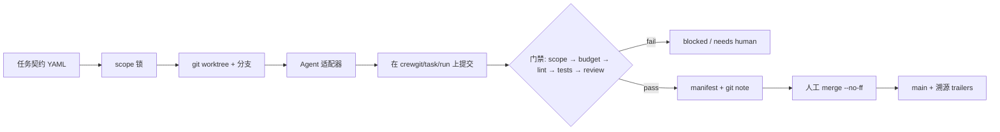

<div align="center">
  
</div>

<h1 align="center">CrewGit</h1>

<p align="center"><strong>Git 本来就是多智能体协议。</strong><br>
让一组编程 Agent 在同一个仓库里干活，而不把 <code>main</code> 变成 merge 事故现场。</p>

<p align="center">
  <a href="https://github.com/kll-92/crewgit/actions/workflows/ci.yml"></a>
  
  
  
</p>

<p align="center">
  <a href="#60-秒-demo零-api-key">Demo</a> ·
  <a href="#快速开始">快速开始</a> ·
  <a href="#工作原理">工作原理</a> ·
  <a href="README.md">English</a> ·
  <a href="specs/001-prd.md">PRD</a>
</p>

---

## 问题

2026 年，你完全可以同时开三五个编程 Agent。但协作方式还停留在手工时代。

- **它们共用一个工作区。** 两个 Agent 改同一个文件，一个 `git add -A`，你一下午都在拆一个没人能 review 的 diff。
- **产出是聊天记录。** “做完了”不是可审查的交付物。没有 commit 可以 blame，没有门禁结果可以查，也没法复现当时到底跑了什么。
- **给 Agent commit 权限等于给钥匙。** 它可以在“修个拼写”的时候顺手改 migrations、CI 或 lockfile。

编排框架解决的是**单个运行时内部**的控制流。它们不解决多个独立 Agent 对**同一个仓库**的协作。Git 二十年前就为人类解决了：分支、审查、合并、blame、revert。Agent 只是更快、更字面地执行规则的贡献者。

## 方案

**给每个 Agent 一份和人类贡献者相同的待遇：任务、分支、审查、可追溯记录。**

| | CrewGit 提供什么 |
|---|---|
| **任务契约** | 每个任务是提交进仓库的 YAML：scope glob、禁改路径、预算、验收命令、上下文。 |
| **隔离** | 每次 run 有独立 `git worktree` 和分支 `crewgit/<task>/<run>`，并行 Agent 不互相踩。 |
| **门禁** | `scope → budget → lint → tests → review → human`。fail-fast、机器可读、不接受“看着还行”。 |
| **溯源** | commit trailers + `refs/notes/crewgit` manifest：任务、run、Agent、prompt hash、base commit、用量、diff hash、门禁结果。 |
| **复现** | 重跑历史 run 并比较 diff hash。要么同 hash，要么明确标 `diverged`，绝不用 exit code 冒充可复现。 |
| **看板** | 本地 Web 看板 + MCP server。Agent 可以读板、提交分支；合并权始终在人手里。 |

> 别的工具在编排 Agent，CrewGit 让它们“可以入职”。

## 60 秒 Demo（零 API Key）

```bash
pipx install git+https://github.com/kll-92/crewgit.git
crewgit demo
```

Demo 会建一个临时仓库、雇三个 mock Agent，让其中一个试图偷偷改 `pyproject.toml`，拦下它，最后展示完整溯源链。全程离线、确定性输出、不花模型钱。

```text
CrewGit demo
3 agents · 1 repo · 1 blocked scope violation · 0 merge conflicts

04 · coder T-101 — fix inside scope
scope:pass  budget:pass  lint:skip  tests:pass  review:pass
✓ merged as 0a3691f  (tests ran in an isolated worktree)

05 · coder T-102 — the sneaky version bump
scope:fail
scope: out-of-scope paths: pyproject.toml
attempting to merge T-102 anyway…
✗ merge refused: … fix the gates or use --force --reason
nothing outside the declared scope can reach main — not even with a good intention

08 · provenance and replay
replay T-101: identical diff  sha256:cbe60184dc116… vs sha256:cbe60184dc116…
```

有删节。完整输出见 [`docs/demo-output.txt`](docs/demo-output.txt)，真实终端渲染见 [`docs/assets/demo.svg`](docs/assets/demo.svg)。



*Demo 后的只读看板：三次合并完成，一个任务被 scope 门禁拦下，mock 成本显示为 `unmetered`。*

## 安装

需要 Python 3.10+ 与 Git 2.30+。

```bash
# 推荐：独立 CLI 安装
pipx install git+https://github.com/kll-92/crewgit.git

# 或从源码
git clone https://github.com/kll-92/crewgit.git
cd crewgit
python -m venv .venv && . .venv/bin/activate
pip install -e ".[dev]"
```

PyPI 发布在 Phase 1 路线里；当前从源码安装。

## 快速开始

```bash
crewgit init --project "My App"
```

会创建 `.crewgit/config.yaml`、`.crewgit/tasks/` 和运行时排除项；不会替你提交，配置由你 commit。

接入真实 Agent（`generic` 可包装任何接受 prompt 文件的 CLI）：

```bash
crewgit agent add coder --adapter claude --model claude-sonnet

crewgit agent add coder \
  --adapter generic \
  --command "aider --yes --no-auto-commits --message-file {prompt_file}"
```

写任务契约，先 commit，再运行：

```yaml
# .crewgit/tasks/T-101.yaml
id: T-101
title: Fix discount rounding to cents
agent: coder
scope: ["src/cart.py", "tests/test_cart.py"]
forbid: ["pyproject.toml", ".github/**"]
acceptance:
  tests: "python -m pytest -q tests/test_cart.py"
budget:
  max_files: 2
  max_lines: 14
context: |
  Rounding currently truncates to one decimal. Cents must be preserved.
  Do not change the public API.
```

```bash
crewgit task check                 # 校验契约、依赖、环
crewgit run T-101 --agent coder    # 隔离 worktree → Agent → 门禁 → manifest
crewgit show R-20261123-… --diff   # 看这次 run 和真实 diff
crewgit board                      # todo / blocked / running / review / done
crewgit merge R-20261123-…         # 人来合，--no-ff，自动带 trailers
```

想先看解析后的计划和实际命令、不烧 token：

```bash
crewgit run T-101 --agent coder --dry-run
```

## 工作原理



1. **锁 scope。** 活跃 run 预留文件 glob；冲突的第二个 run 等待或快速失败，不会静默撞车。
2. **切 worktree。** 从当前 base commit `git worktree add`，分支 `crewgit/<task>/<run>`。Agent 在真实 checkout 里工作，不是你脏工作区的 stash 副本。
3. **跑 Agent。** 适配器拿到确定性 prompt：契约、scope、验收、base commit。prompt hash 进 manifest，“这段代码是哪版 prompt 产出的”有答案。
4. **提交结果。** CrewGit 在 worktree 内提交、计算 diff，空 diff 或超预算直接拒绝。
5. **过门禁。** scope/budget 从 diff 计算；lint/tests 带超时和清洗过的环境；review 要求 reviewer Agent 返回 JSON 裁决。解析不了 → `needs_human`，不算通过。
6. **记录一切。** manifest 落在 `.crewgit/runs/`，溯源写进 `refs/notes/crewgit`，合并 commit 带 trailers。
7. **人来合并。** CrewGit 从不自动 merge。`merge` 必须显式、`--no-ff`；失败 run 只能 `--force --reason`，且会被计数、展示、审计。

### 门禁

| 门禁 | 检查什么 | 失败意味着 |
|---|---|---|
| `scope` | 变更路径匹配 `scope` 且避开 `forbid` | 越界工作永远到不了 main。 |
| `budget` | `max_files` / `max_lines` | 任务比契约大，拆任务。 |
| `lint` | 配置的命令（null 则 skip） | 风格/类型回归。 |
| `tests` | 任务 `acceptance.tests` 或全局命令（null 则 skip） | 验收命令失败或超时。 |
| `review` | reviewer 返回 JSON 裁决（`approve` 或 `revise`，附理由） | 无法解析 → `needs_human`；reviewer 改文件 → 边界违规。 |

默认 `fail_fast: true`：scope/budget 过了才跑 lint，tests 过了才跑 review。更省、更容易定位责任。

### 溯源

```text
$ git log -1 --format=%B
merge: T-101 Fix discount rounding to cents

CrewGit merge of R-… by coder (claude-sonnet).

Crewgit-Task: T-101
Crewgit-Run: R-…
Crewgit-Agent: coder
Crewgit-Contract-Hash: sha256:…
```

```bash
git log --show-notes=crewgit      # 完整 manifest，可随 refs/notes/crewgit 推送
git push origin refs/notes/crewgit                          # 把溯源和分支一起发布
git fetch origin refs/notes/crewgit:refs/notes/crewgit      # 新克隆后先取 notes
crewgit replay R-…                # 同 diff hash，或明确 diverged
```

查不了的 run 不值得信任。manifest 只在适配器如实上报时记录用量和成本；未知就写 `null` / `unmetered`，绝不伪造 `$0.0000`。

## 适配器与 MCP

| 适配器 | 用途 | 说明 |
|---|---|---|
| `mock` | Demo、测试、CI | 用 `mock_actions` 产出确定性补丁，不联网。 |
| `generic` | Aider、Codex CLI、Gemini CLI、自写脚本 | 命令模板支持 `{prompt_file}`、`{worktree}`、`{task_id}`、`{run_id}`、`{agent}`、`{base_commit}`、`{repo_root}`。 |
| `claude` | Claude Code | 内置命令形态，透传 `{prompt_file}`。 |

MCP：让外部 Agent 入队，但不给它合并权。

```json
{
  "mcpServers": {
    "crewgit": {
      "command": "crewgit",
      "args": ["mcp", "-C", "/path/to/repo"]
    }
  }
}
```

工具：`crewgit_list_tasks`、`crewgit_get_task`、`crewgit_get_board`、`crewgit_submit_run`。`submit_run` 接收 Agent 已提交的分支，跑门禁、记录溯源，**不会合并**。

## 命令

| 命令 | 作用 |
|---|---|
| `crewgit init` | 创建 `.crewgit/`、配置、排除项；可 `--init-git`。 |
| `crewgit agent list/add/remove` | 管理 `config.yaml` 里的 Agent 名单。 |
| `crewgit task list/show/new/check` | 契约、依赖、环检测。 |
| `crewgit run <task>` | 单任务 / 就绪集 / 并行批量；`--dry-run`、`--json`。 |
| `crewgit board` / `show <run>` | 状态、门禁、diff、溯源。 |
| `crewgit merge <run>` / `reject` | 人工决策；`--force --reason` 留痕。 |
| `crewgit replay <run>` | 重跑并比较 diff hash。 |
| `crewgit stats` / `doctor` / `gc` | 成本台账、健康检查、worktree 清理。 |
| `crewgit serve` | 本地看板 UI + REST API；`--read-only` 适合演示。 |
| `crewgit mcp` | MCP stdio server。 |
| `crewgit demo` | 离线端到端 Demo。 |

所有读命令支持 `--json`。

## 对比

| | 编排框架 | 单 diff 风险门禁 | CrewGit |
|---|---|---|---|
| 工作单元 | 一个运行时图里的节点 | 一个 diff | 契约 + run + 分支 + commit |
| 单仓库并行 Agent | 共享状态，隔离靠手工 | 不是它的职责 | 每 run 一个 worktree + scope 锁 |
| 审查产物 | 聊天记录 / trace | 一个裁决 | commit + manifest + git note |
| 复现一次 run | 重放图 | 重跑检查 | `crewgit replay`：同 hash 或 diverged |
| 合并权 | 框架 | hook | 人，显式、留痕 |
| 成本 | 框架面板 | — | 按 run；未知保持未知 |

CrewGit 不是编排器、不是托管 SaaS、也不是模型路由。它是你现有 Agent 运行时下面的协作层。

## 设计原则

完整[宪法](specs/000-constitution.md)很短，且可执行。塑造成代码的是这几条：

- **先规格后代码。** 行为变更从 `specs/` 开始，不从 commit message 开始。
- **Git 是唯一事实源。** 看板、manifest、notes 都是索引，仓库才是记录。
- **一任务、一分支、一 worktree、一 run。**
- **红灯不许合。** 覆盖必须 `--force --reason`，且被计数。
- **溯源是功能，不是日志。** 没进 manifest 和 note 的，就等于没发生。
- **复现必须诚实。** 同 diff hash，或者写 `diverged`。
- **信任要显式。** Agent 的权限等价于 Makefile；P0 不做容器隔离，不喂环境里的秘密。

## 路线图

- **Phase 0 — 已完成：** 本地 MVP、五道门禁、溯源、复现、看板、MCP、离线 Demo、42 项测试。
- **Phase 1 — 团队可用：** PyPI、`crewgit-gate` GitHub Action、Codex/Aider/Gemini 适配器、merge queue、Docker 只读看板、90 秒视频。
- **Phase 2 — 生态：** 门禁插件 SDK、签名 manifest、带 USD 上限的远程 runner、monorepo scope、Windows GA。
- **Phase 3 — 规模：** per-agent 身份、策略包、托管只读看板、A2A/MCP 联邦。

细节与 kill criteria 见 [`specs/003-roadmap.md`](specs/003-roadmap.md)。

## 限制（信任它之前先读）

- **单机。** worktree 和锁都在本地，远程 runner 在 Phase 2。
- **没有沙箱。** Agent 能跑适配器允许的任何命令。用一次性 checkout 和清洗过的环境，别指向生产凭证。
- **不自动合并。** 这是刻意的。合并是人的决定，直到 Phase 1 的 merge queue。
- **复现对确定性适配器是精确的。** LLM Agent 可能发散，CrewGit 会标 `diverged`，不装作可复现。
- **Python 3.10–3.13，Linux/macOS。** CI 覆盖这些；Windows 在 Phase 2 前是尽力支持。

## 贡献

先读 [`CONTRIBUTING.md`](CONTRIBUTING.md) 和 [`specs/000-constitution.md`](specs/000-constitution.md)。小步、有测试、每次改动单独提交。新适配器和门禁插件是最快的入口。

```bash
make install   # 可编辑安装 + dev extras
make test      # pytest
make lint      # ruff
make demo      # 在 ./crewgit-demo 跑离线 Demo
```

安全模型与漏洞上报： [`SECURITY.md`](SECURITY.md)。

## 许可证

MIT，见 [`LICENSE`](LICENSE)。

---

<p align="center"><em>如果 CrewGit 帮你省下一次 merge 冲突，点个 star 能让下一个 Agent 团队找到它。</em></p>
