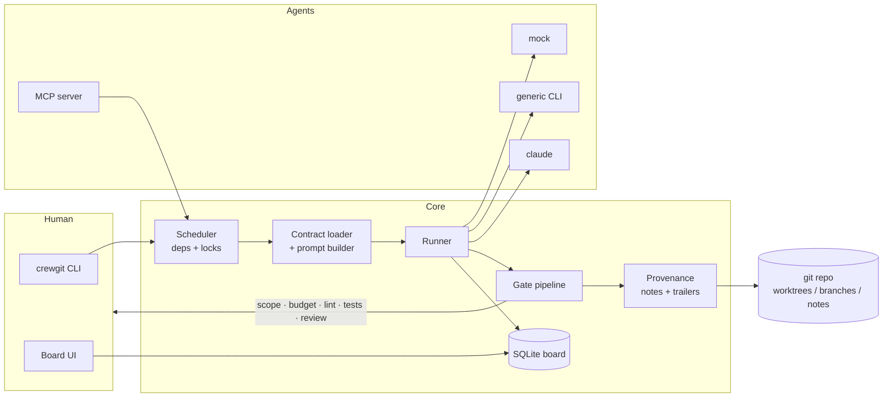
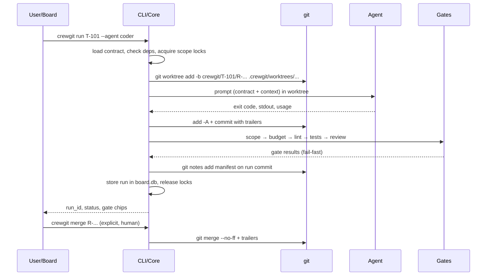

# 002 — Technical Design · 技术框架文档

> **Version:** 0.1 · **Status:** approved for P0 · **Last updated:** 2026-11-23
> **Companions:** `000-constitution.md` (rules), `001-prd.md` (requirements), `003-roadmap.md` (phases)

---

## 1. Architecture at a glance

CrewGit is a thin collaboration layer between **any coding agent** and **one git repository**. It does
not run an agent runtime; it prepares a workspace, invokes the agent, inspects the result, and
records what happened.



**Data flow for one run:**



## 2. Design principles

1. **Git is the database of record.** Branches, commits, notes, trailers. SQLite is a cache for the
   board and locks, never the source of truth. Deleting `.crewgit/` must not lose code history.
2. **The agent is untrusted input.** Its diff is inspected, never assumed correct. Gates are the
   boundary, not the prompt.
3. **Everything is inspectable.** A reviewer can reconstruct a run from the manifest alone: prompt,
   base commit, agent, gates, diff hash, cost.
4. **Boring tech, fast start.** Python + Typer + FastAPI + stdlib sqlite3. No daemon, no queue, no
   cloud. One process for CLI, one for the board, both read the same repo.
5. **Deterministic demo first.** The `mock` adapter proves the plumbing without keys, network, or
   model nondeterminism.

## 3. Repository layout

```text
<project>/
├── crewgit.yaml                 # optional project manifest (name, default branch, plugins)
├── tasks/                       # task contracts, reviewable YAML, committed
│   ├── T-100-plan.yaml
│   └── T-101-fix-discount.yaml
├── .crewgit/                    # runtime, gitignored
│   ├── config.yaml              # agents, gates, budgets
│   ├── board.db                 # runs + locks (sqlite)
│   ├── worktrees/<task>-<run>/   # one per active/past run
│   └── runs/<run_id>.json       # local manifest copy
└── (your normal source tree)
```

Source package layout:

```text
src/crewgit/
├── cli.py            # Typer commands, rich output, --json
├── config.py         # config + paths + env
├── models.py         # Task, Gate, Run dataclasses, YAML/JSON schemas
├── contracts.py      # validation, prompt building, hashing
├── gitops.py         # worktree/branch/diff/commit/notes/merge primitives
├── store.py          # sqlite board + locks
├── gates.py          # scope, budget, lint, tests, review gates
├── runner.py         # single run + parallel ready-set execution
├── demo.py           # deterministic end-to-end demo
├── server.py         # FastAPI board + REST
├── mcp.py            # MCP stdio server
├── agents/
│   ├── base.py       # Adapter ABC, RunContext, AgentResult
│   ├── mock.py       # deterministic role agents + mock_actions
│   ├── generic.py    # any CLI via command template
│   ├── claude.py     # claude CLI adapter
│   └── registry.py   # build adapter from config
└── web/              # index.html, app.js, style.css (no build step)
```

## 4. Configuration

`.crewgit/config.yaml` (generated by `crewgit init`):

```yaml
version: 1
project: demo-shop
default_branch: main
gates:
  fail_fast: true
  timeout_s: 600
  budget: { max_files: 6, max_lines: 300 }
  lint: { command: null }          # null disables; e.g. "ruff check ."
  tests: { command: "python -m pytest -q" }
  review: { mode: agent, agent: reviewer }   # off | agent
agents:
  planner:  { adapter: mock, role: planner }
  coder:    { adapter: mock, role: coder }
  reviewer: { adapter: mock, role: reviewer }
  aiden:    { adapter: generic, command: "aider --yes --message-file {prompt_file}" }
environment:
  passthrough: []                  # extra env vars the agent may see
```

Rules:
- `gates.tests.command` is the project default; a task's `acceptance.tests` overrides it.
- `gates.review.mode=agent` requires `review.agent` to exist in `agents`.
- Agent config is trusted input (it is a command you chose to run). See §11.

## 5. Task contract schema

`tasks/T-101.yaml`:

```yaml
id: T-101
title: Fix discount rounding for multi-item carts
agent: coder                 # preferred agent; CLI --agent overrides
depends_on: [T-100]          # blocked until these tasks are merged
scope:                       # the ONLY paths this agent may touch (globs)
  - src/cart.py
  - tests/test_cart.py
forbid:                      # extra exclusions, always wins over scope
  - .github/**
acceptance:
  tests: "python -m pytest -q tests/test_cart.py"   # optional override
  lint: null                                        # optional override
  review: true                                      # set false to skip review gate
budget:
  max_files: 3
  max_lines: 80
context: |
  Cart totals round half-up; the discount must apply before tax.
mock_actions:                # used by the mock adapter (and demo/tests)
  - { op: patch, path: src/cart.py, find: "round(total, 1)", replace: "round(total, 2)" }
```

Validation rules (all errors are typed `ContractError` with the field path):

| Rule | Detail |
|---|---|
| `id` | `^[A-Za-z0-9][A-Za-z0-9._-]{1,63}$`, unique across `tasks/` |
| `title` | 1–120 chars |
| `scope` | non-empty list of globs; `.crewgit/**` and `tasks/**` are implicitly forbidden |
| `depends_on` | must reference known task ids; cycles rejected at load |
| `budget` | positive ints; defaults from config |
| `acceptance` | commands are strings or null; never executed during validation |
| `mock_actions` | `op ∈ {write, patch, delete}`, `path` must be inside `scope` (the mock adapter is allowed to cheat, but tests assert the gate catches out-of-scope `write`) |

## 6. Run manifest schema

Stored as `.crewgit/runs/<run_id>.json` and as a git note on the run commit (`refs/notes/crewgit`).

```json
{
  "schema": 1,
  "run_id": "R-20261123-1620-a1b2",
  "task_id": "T-101",
  "title": "Fix discount rounding for multi-item carts",
  "agent": "coder",
  "adapter": "mock",
  "model": "mock/deterministic",
  "base_commit": "3f2a1c9...",
  "branch": "crewgit/T-101/R-20261123-1620-a1b2",
  "worktree": ".crewgit/worktrees/T-101-R-20261123-1620-a1b2",
  "prompt_sha256": "sha256:9c1f...",
  "prompt": "…full prompt text…",
  "started_at": "2026-11-23T16:20:11+08:00",
  "finished_at": "2026-11-23T16:20:13+08:00",
  "duration_ms": 2140,
  "exit_code": 0,
  "usage": { "input_tokens": null, "output_tokens": null, "cost_usd": null, "note": "mock adapter is unmetered" },
  "commit": "8b7d4e0...",
  "changed_files": ["src/cart.py", "tests/test_cart.py"],
  "diff_stat": { "files": 2, "insertions": 31, "deletions": 6 },
  "diff_sha256": "sha256:41aa...",
  "gates": [
    { "name": "scope",  "status": "pass", "detail": "2 files within declared scope", "duration_ms": 3 },
    { "name": "budget", "status": "pass", "detail": "31/80 lines, 2/3 files", "duration_ms": 2 },
    { "name": "tests",  "status": "pass", "detail": "12 passed in 0.8s", "duration_ms": 940 },
    { "name": "review", "status": "pass", "detail": "{\"verdict\":\"approve\"}", "duration_ms": 120 }
  ],
  "status": "passed",
  "override": null,
  "replay_of": null
}
```

Statuses:

| Field | Values |
|---|---|
| `run.status` | `running`, `passed`, `failed`, `needs_human`, `merged`, `rejected`, `forced` |
| `gate.status` | `pass`, `fail`, `skip`, `error` |
| derived `task.status` | `todo`, `blocked`, `running`, `review`, `done` |

Task status derivation (`todo` → latest run `none` and deps unmet is `blocked`; latest run `passed`
but not merged is `review`; any `merged` run wins as `done`; latest `failed` is `blocked`).

## 7. Gates

Order and semantics (fail-fast by default):

| Gate | What it checks | Failure payload |
|---|---|---|
| `scope` | every changed path matches a `scope` glob and no `forbid` glob; `.crewgit/**`/`tasks/**` always rejected | offending paths list |
| `budget` | `changed files ≤ max_files` and `insertions+deletions ≤ max_lines` | actual vs allowed |
| `lint` | configured command, exit code | last 2 000 chars of output |
| `tests` | task override or project default, exit code | last 4 000 chars |
| `review` | reviewer adapter reads the diff, must print one JSON object `{"verdict":"approve"\|"revise","notes":[...]}` | `revise` → run `failed`; unparseable → `needs_human` |

Rules:
- Commands run with `cwd=worktree`, scrubbed env, and `timeout_s`.
- `skip` is recorded explicitly (e.g. no `lint.command`) — never silently omitted.
- Review gate runs the reviewer in the same worktree; if the worktree becomes dirty afterwards, the
  gate fails with `reviewer_boundary_violation`.
- Overrides: `crewgit merge --force --reason "..."` sets `run.status=forced` and writes
  `Crewgit-Override: <reason>` on the merge commit. Overrides are reported in `crewgit stats`.

## 8. Git conventions

| Item | Value |
|---|---|
| branch | `crewgit/<task-id>/<run-id>` |
| worktree | `.crewgit/worktrees/<task-id>-<run-id>` |
| run commit subject | `<type>(<task-id>): <task title>` (agent output is the body, if any) |
| notes ref | `refs/notes/crewgit`, one note per run commit |
| merge | `--no-ff` into `main`, message `merge: <task-id> <title>` |
| trailers | `Crewgit-Task`, `Crewgit-Run`, `Crewgit-Agent`, `Crewgit-Contract-Hash`, optional `Crewgit-Override` |

Why notes rather than a sidecar file: notes travel with history, survive `git clone` when pushed
(`git push origin refs/notes/crewgit`), and are readable by plain `git log --show-notes=crewgit`.
Trade-off: notes refs merge-commit like any ref; conflicts are resolved by last-writer or
`-f`, documented in §12.

## 9. Scheduling and concurrency

- **Ready set:** tasks whose `depends_on` tasks all have a `merged` run.
- **Locks:** a run acquires every declared `scope` pattern in `board.db` (`locks` table, TTL
  `timeout_s + 600`). Two runs whose patterns overlap (glob-vs-glob intersection test via path
  prefix/`fnmatch` heuristics) cannot start concurrently; the second is `blocked` with reason
  `scope_locked`.
- **Parallel execution:** `crewgit run --ready --parallel N` uses a thread pool. Each run has its own
  worktree (own index), so git operations are independent. Note writes are serialized with a filesystem
  lock (`.crewgit/notes.lock`) plus retry, because notes live in a shared ref.
- **Merge is serialized and explicit.** Never automatic after a gate passes; a human (or CI policy)
  calls `crewgit merge`.

## 10. Adapter protocol

```python
class Adapter(ABC):
    name: str
    def run(self, ctx: RunContext) -> AgentResult: ...
```

`RunContext` carries: task, agent name/config, run_id, worktree path, prompt text and prompt file
path, base commit, timeout, dry_run, scrubbed env.

`AgentResult` carries: `exit_code`, `stdout`, `stderr`, optional `usage` (tokens/cost), optional
`model`, optional `notes`.

| Adapter | Behaviour | Metering |
|---|---|---|
| `mock` | Executes `mock_actions` in order (write/patch/delete); role `planner` writes `docs/plan-<task>.md`; role `reviewer` returns a deterministic verdict from the diff | none (nulls with a note) |
| `generic` | Expands `{prompt_file}`, `{worktree}`, `{task_id}`, `{run_id}` into the configured command, runs via `/bin/sh -c` | parses nothing by default |
| `claude` | `claude -p <prompt> --output-format json` in the worktree; parses `total_cost_usd` and token counts when present | native |

Prompt template (`contracts.build_prompt`) is deterministic: same contract + same base commit →
same `prompt_sha256`. Sections: role, task, scope, definition of done, budget, context, hard rules
(no `git commit`, no edits outside scope, no edits to `.crewgit/` or `tasks/`).

## 11. Security and trust model

CrewGit runs commands the user configured, with the user's privileges. This is equivalent to running
a `Makefile`. Mitigations, not guarantees:

1. **Explicit registration.** Agents exist only because a human wrote them into `config.yaml`.
2. **Dry run.** `crewgit run --dry-run` prints the resolved command, env diff, branch, and worktree
   without executing anything.
3. **Env allowlist.** Default passthrough: `PATH`, `HOME`, `LANG`, `LC_*`, `TERM`, `TZ`,
   `CREWGIT_*`. Everything else (API keys, cloud credentials, SSH agent vars) is dropped unless
   declared in `environment.passthrough`.
4. **No secrets in artefacts.** Prompts and manifests are hashed and stored; the runner redacts values
   of env vars whose names match `*TOKEN*`, `*KEY*`, `*SECRET*`, `*PASSWORD*` if they ever appear.
5. **Boundary checks after the fact.** The `scope` gate is the enforcement point, not the prompt.
   Review gates cannot approve out-of-scope diffs.
6. **Dirty-tree refusal.** No run starts if the main worktree is dirty; CrewGit never stashes.
7. **Documented residual risk.** An agent can run arbitrary commands inside its worktree sandbox
   boundary (which is just a directory). Strong isolation (containers/VMs) is roadmap P2, not a
   claim of P0.

## 12. Failure taxonomy and recovery

| Failure | Symptom | Recovery |
|---|---|---|
| Agent crash / non-zero exit | run `failed`, stderr captured | fix contract/prompt, rerun |
| Gate fail | specific gate `fail` with payload | revise task or agent; `crewgit run` again |
| Out-of-scope edit | `scope` fail listing paths | narrow the agent or widen the contract deliberately |
| Review unparseable | `needs_human` | human reads diff, then `merge --force --reason` or reject |
| Merge conflict on `main` | merge aborts, `main` untouched | rebase the run branch via `crewgit rebase <run>` (P1), or rerun on new base |
| Stale lock | task `blocked: scope_locked` | `crewgit doctor` then `crewgit gc --locks` |
| Notes ref conflict | note write retries then errors | `crewgit notes repair` (last-writer) documented |
| Missing note after clone | `crewgit show` falls back to local manifest | `git fetch origin refs/notes/crewgit:refs/notes/crewgit` |

`crewgit doctor` reports: dirty main tree, orphan worktrees, stale locks, branches without runs,
notes ref missing, config/schema version mismatch.

## 13. Web board and API

FastAPI, static assets under `src/crewgit/web/`, no build step, no JS framework.

| Method | Path | Purpose |
|---|---|---|
| GET | `/api/health` | liveness + version |
| GET | `/api/board` | tasks with derived status, latest run, gate chips, cost |
| GET | `/api/agents` | configured agents and adapters |
| GET | `/api/tasks/{id}` | contract + runs |
| GET | `/api/runs/{id}` | manifest |
| GET | `/api/runs/{id}/diff` | unified diff (text/plain) |
| POST | `/api/tasks/{id}/run` | start a run (body: `{agent?}`) |
| POST | `/api/runs/{id}/merge` | merge (body: `{force?, reason?}`) |
| POST | `/api/runs/{id}/reject` | reject with reason |

UI: five columns (todo / running / review / done / blocked), cards with agent badge, gate chips
(pass/fail/skip/needs_human), diff stats, cost, and buttons that call the API. Polling every 3 s.
Read-only mode (`crewgit serve --read-only`) disables POSTs for shared dashboards.

## 14. MCP server

`crewgit mcp` speaks JSON-RPC 2.0 over stdio. Handshake: `initialize` → `{protocolVersion:
"2024-11-05", capabilities: {tools: {}}, serverInfo: {name: "crewgit", version}}`;
`notifications/initialized` ignored; `tools/list`; `tools/call`.

| Tool | Args | Returns |
|---|---|---|
| `crewgit_list_tasks` | `{}` | tasks + derived status + deps |
| `crewgit_get_task` | `{task_id}` | contract + latest run + gate chips |
| `crewgit_get_board` | `{}` | board summary + cost totals |
| `crewgit_submit_run` | `{task_id, agent, branch, commit, summary?}` | registers an externally produced branch as a run, executes gates, returns `run_id` + verdict |

`merge` is deliberately not exposed: merging stays a human decision. Write tools return
`isError: true` with a typed message on contract violations.

## 15. Performance targets

| Path | Target | Notes |
|---|---|---|
| CLI startup | < 300 ms | lazy imports for server/mcp |
| git overhead per run | < 2 s | worktree add + commit + notes + diff |
| Board API | < 100 ms for 50 tasks | sqlite + one manifest read |
| Parallel 3 runs | linear speedup vs sequential for mock agents | isolation is the point |

## 16. Testing strategy

| Layer | What | How |
|---|---|---|
| Unit | contract validation, prompt hash determinism, scope/budget gate logic, status derivation | pure functions, no git |
| Integration | worktree lifecycle, commit trailers, notes round-trip, merge, replay diff hash | temp git repos via fixture |
| E2E | `crewgit demo` completes, one scope violation blocked, final `main` green | subprocess smoke test, ~5 s |
| API | board JSON shape, run/merge endpoints | FastAPI TestClient (httpx), skipped if unavailable |
| Static | `ruff check` | CI |

No network in tests. No real LLM in tests. The mock adapter is the contract for determinism.

## 17. Architecture decisions (ADRs)

| # | Decision | Alternatives | Why |
|---|---|---|---|
| 1 | Git worktrees per run | full clones; in-place branches | cheap, shares object store, isolated index, instant cleanup |
| 2 | Manifests as git notes | sidecar JSON only; database only | provenance travels with history; no server needed |
| 3 | Task contracts as committed files | database rows; UI-created tasks | reviewable in PRs, diffable, portable |
| 4 | SQLite only for runs/locks | pure JSON files | board queries and lock TTLs are easier; still disposable |
| 5 | Python + Typer + FastAPI | Node/TS; Rust | fastest path to cross-platform CLI + web with rich output; perf is subprocess-bound |
| 6 | Mock adapter in core | require a real LLM | demo and tests must work offline; determinism is testable |
| 7 | Attribution by trailers/notes, not per-agent committer identity | agent-specific git users | keeps history clean; identity model deferred to P2 |
| 8 | Fail-fast gates, review last, human merge | auto-merge on green | trust is the product; auto-merge is a P2 opt-in |

## 18. Compatibility and limits (P0)

- macOS and Linux; Python 3.10–3.13; Git ≥ 2.30.
- Windows: worktrees exist, but hooks/path length are untested → documented as unsupported in P0.
- Submodules and Git LFS are not specially handled; `doctor` warns.
- Notes conflicts across concurrent machines: last-writer-wins with `-f`; documented, not hidden.
- One repository per CrewGit board; multi-repo is P2.
